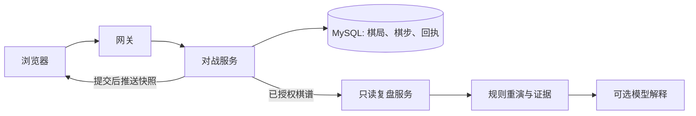

# PlayRoom | 五子棋对战与棋局复盘

PlayRoom 是一个双人在线五子棋项目。公开作品集提供可运行的棋盘 Demo、Java 棋规、房间状态机和棋局复盘的规则证据生成代码。完整系统中的登录、MySQL 持久化、实时通知和独立复盘服务在下方架构中说明。

[开发时间线](docs/development-log.md) · [Java 棋规](backend/playroom-core/src/main/java/dev/playroom/core/GomokuRules.java) · [复盘证据](backend/playroom-review-contract/src/main/java/dev/playroom/review/RuleEvidence.java) · [公开提交记录](https://github.com/Yiyan2626/PlayRoom-Portfolio/commits/main/)

## 三分钟看懂项目

| 想看什么 | 从哪里读 |
| --- | --- |
| 一局棋如何验证落子、回合和胜负 | [GameState](backend/playroom-core/src/main/java/dev/playroom/core/GameState.java)、[棋规测试](backend/playroom-core/src/test/java/dev/playroom/core/GomokuRulesTest.java) |
| 玩家就座、准备、开局和房间状态怎么关联 | [Room](backend/playroom-core/src/main/java/dev/playroom/core/Room.java)、[房间生命周期测试](backend/playroom-core/src/test/java/dev/playroom/core/RoomLifecycleTest.java) |
| 复盘怎样从棋谱重放，产出可引用的事实 | [RuleEvidence](backend/playroom-review-contract/src/main/java/dev/playroom/review/RuleEvidence.java)、[规则证据测试](backend/playroom-review-contract/src/test/java/dev/playroom/review/RuleEvidenceTest.java) |
| 如何检查一步成五、挡住对方和只读试落 | [BoardAnalysis](backend/playroom-review-contract/src/main/java/dev/playroom/review/BoardAnalysis.java)、[分析测试](backend/playroom-review-contract/src/test/java/dev/playroom/review/BoardAnalysisTest.java) |

完整系统中，一步落子由已验证账号发送。服务端检查房间成员、棋局版本和规则，数据库事务提交棋步及回执后才更新内存并推送快照。复盘服务只接收已授权的棋谱事实，Java 负责重演与规则判断，模型负责解释。只读试落产生临时局面，不写回真实棋局。



上图描述完整工程。此仓库的浏览器 Demo 使用本地模拟数据，不连接线上对战、数据库或模型。公开 Java 模块用于独立运行棋规和复盘证据测试。

## 体验与复跑

用 Python 3 启动 Demo，打开终端显示的 `http://127.0.0.1:8765`。页面内可以切换模拟玩家、建房、准备、落子和回放。

```bash
python demo/serve.py
```

检验 Java 21 / Maven 3.9 和 Node.js 20+ 下的公开代码：

```bash
mvn -B -f backend/pom.xml verify
node --test demo/tests/model.test.mjs
```

两组测试不需要 MySQL、云服务、API Key 或账号。第一次构建 Maven 会下载公开依赖。依赖及来源见[说明](docs/sources.md)。

## 开发记录怎么读

公开仓库于 2026-11-18 从经筛选的项目代码建立。[开发时间线](docs/development-log.md)记录原工程中已核对的真实日期与成果；早期日期是历史整理，不是补造的公开提交。之后本仓库的真实变化可以直接在 `main` 的提交记录查看。
